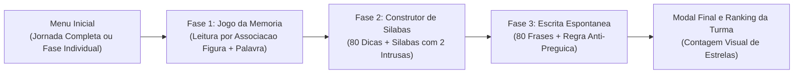

# Saúde na Escola: Saúde Bucal — Aplicação Educativa Web

Software educativo desenvolvido para apoiar o processo de alfabetização inicial e a conscientização sobre higiene bucal em turmas do 1º e 2º Ano do Ensino Fundamental. O projeto foi concebido para execução prioritária em Lousas Digitais (Telas Interativas Touch) durante as aulas e na Mostra Escolar, além de funcionar de forma responsiva em computadores e smartphones.

---

## 1. Identificação e Metodologia de Trabalho

- **Aplicação Online (GitHub Pages):** [https://joaodoamaral6.github.io/jogo-saude-bucal/](https://joaodoamaral6.github.io/jogo-saude-bucal/)
- **Repositório Oficial:** [https://github.com/joaodoamaral6/jogo-saude-bucal](https://github.com/joaodoamaral6/jogo-saude-bucal)
- **Desenvolvedor e Analista de Requisitos:** João Carlos do Amaral de Oliveira — Estudante de Engenharia de Software (2º Semestre)
- **Especialista de Domínio e Validação Pedagógica (Stakeholder):** Profª Carla Machado (Docente do 1º / 2º Ano do Ensino Fundamental)
- **Ferramentas de Apoio ao Desenvolvimento:** Google Antigravity (CLI `agy`) e Gemini

### Papel de Engenharia e Processo de Construção

Como estudante do 2º semestre de Engenharia de Software com base em Front-End (HTML, CSS e JavaScript), conduzi este projeto a partir de uma demanda real de sala de aula para a Mostra Escolar da turma da professora Carla Machado.

Utilizei o Google Antigravity como ferramenta de apoio na geração e refatoração do código, concentrando minha atuação nas etapas fundamentais de Engenharia de Software:
1. **Elicitação de Requisitos e Estudo do Usuário:** Levantamento das necessidades reais de uma turma de 16 crianças em fase de alfabetização (6 a 7 anos) e das restrições físicas do uso coletivo de uma lousa digital.
2. **Validação Prévia e Prototipação Iterativa:** Antes de consolidar novas funcionalidades ou bancos de texto no código, submeti cada proposta à avaliação da professora titular para validar a adequação vocabular, pedagógica e matemática.
3. **Testes de Qualidade (QA) e Inspeção Crítica:** Realizei testes constantes em computador e celular (em modos retrato e paisagem), identificando bugs de estado, falhas de espaçamento, problemas de corte de rodapé em navegadores móveis e termos que precisavam de revisão semântica.
4. **Compreensão da Arquitetura:** Acompanhei e estudei a estrutura técnica de cada seção implementada para compreender o funcionamento interno das regras de CSS, da máquina de estados em JavaScript e das APIs nativas utilizadas.

---

## 2. Contexto de Uso e Perfil dos Usuários

### 2.1. Dinâmica de Sala de Aula e Mostra Escolar
O sistema foi projetado para uma dinâmica presencial onde **um participante por vez** vai até a lousa interativa. Durante as aulas, todos os **16 alunos da turma** participam em sequência; no dia da **Mostra Escolar**, além dos alunos, os visitantes também interagem com o jogo na tela touch e pelo link em seus celulares.

### 2.2. Perfil Cognitivo e Físico da Turma (1º Ano — 6 a 7 anos)
- **Transição na Alfabetização:** Os alunos encontram-se na transição entre o reconhecimento visual de figuras, a consciência fonológica/silábica (unir pedaços sonoros para formar palavras) e a escrita alfabética espontânea. Por esse motivo, 100% da tipografia utiliza obrigatoriamente **CAIXA ALTA** (letras bastão maiúsculas), frases diretas e vocabulário compatível com a faixa etária.
- **Ergonomia Física na Lousa Digital:** Devido à estatura das crianças de 6 e 7 anos, elas não alcançam o topo da lousa interativa. Além disso, movimentos de arrastar e soltar (*drag-and-drop*) costumam falhar na coordenação motora fina sobre telas grandes, exigindo que toda a interação ocorra por **toque simples (clique)** posicionado na metade inferior da tela.
- **Noção Matemática Inicial:** No 1º ano, a matemática trabalha contagem direta um a um e comparação de quantidades baixas (conceitos de **Maior e Menor**). Pontuações abstratas altas (como 100 ou 500 pontos) foram descartadas em favor de numerais baixos acompanhados de estrelas desenhadas lado a lado para contagem visual.

---

## 3. Concepção Pedagógica e Estrutura das 3 Fases

Para ir além de um simples jogo de perguntas e respostas, o vocabulário de Saúde Bucal foi estruturado em **10 palavras-chave** (`BOCA`, `DENTE`, `PASTA`, `ESCOVA`, `SORRISO`, `FIO`, `ÁGUA`, `CÁRIE`, `LÍNGUA` e `GENGIVA`) distribuídas em três níveis progressivos de dificuldade.

No **Menu Inicial**, o usuário pode escolher jogar qualquer fase isoladamente (trabalhando as 10 palavras) ou jogar a **Jornada Completa**, que percorre as 3 fases em sequência sorteando um subconjunto de 5 palavras nas Fases 2 e 3 para manter a partida ágil e não cansar os demais alunos que aguardam na fila.

### Fase 1: Jogo da Memória (Figura + Palavra)
- Grade de 8 cartas (4 pares sorteados aleatoriamente por rodada).
- **Exigência de Leitura:** Em vez de formar pares com dois desenhos idênticos (o que levaria a criança a apenas decorar cores e posições), cada par é formado por **1 carta contendo a Ilustração SVG** e **1 carta contendo exclusivamente a Palavra escrita**, estimulando a leitura desde a primeira fase.

### Fase 2: Construtor de Sílabas (Simples e Complexas)
- Na metade superior da tela, exibe a ilustração da palavra e uma dica descritiva (sem revelar a palavra escrita), sorteada de um banco de **80 dicas**.
- Na metade inferior, exibe os espaços vazios correspondentes ao número de sílabas da palavra e botões grandes contendo as sílabas corretas embaralhadas junto com **2 sílabas intrusas**.
- A mecânica funciona por toque simples: ao tocar em uma sílaba disponível, ela sobe para o primeiro espaço vazio; ao tocar em uma sílaba já colocada no espaço, ela retorna para a área inferior. Quando a criança erra a montagem, apenas as sílabas posicionadas incorretamente retornam para baixo, preservando o que ela já acertou.

### Fase 3: Escrita Espontânea (Com Regra Anti-Preguiça)
- Exibe a ilustração e uma frase contextual com lacuna (sorteada de um banco de **80 frases**), acompanhada das caixinhas de letras e de um teclado virtual próprio (`A-Z`, `APAGAR` e `VERIFICAR`) na metade inferior da tela.
- **Tolerância Ortográfica a Acentos:** Nas palavras acentuadas (`ÁGUA`, `CÁRIE`, `LÍNGUA`), a criança não precisa buscar acentos no teclado. Se ela tocar na vogal base (`A` ou `I`), o sistema valida como correto via normalização Unicode (`NFD`) e já exibe a letra acentuada na caixinha.
- **Regra Pedagógica Anti-Preguiça:** O jogo não possui botão de "Ver Resposta". Quando a criança toca em **VERIFICAR**, o algoritmo analisa letra por letra: as letras colocadas na posição correta ficam **fixas e destacadas em verde**, enquanto apenas as letras incorretas são apagadas, exibindo uma mensagem de incentivo para que o aluno descubra somente as letras restantes.

---

## 4. Histórico de Testes, Feedbacks da Professora e Resolução de Problemas

O desenvolvimento seguiu um ciclo rigoroso de inspeção prática, testes em dispositivos reais e validação direta com a professora Carla Machado. Abaixo estão documentados os problemas reais encontrados durante o projeto e as soluções de engenharia aplicadas:

### 4.1. Padronização Visual 100% SVG (Eliminação de Emojis de Sistema)
- **Problema Identificado:** Emojis comuns de texto mudam de aparência dependendo do sistema operacional (Windows da lousa, Android, iOS ou Linux), podem falhar no carregamento e conferem um aspecto improvisado à interface.
- **Solução Aplicada:** Foi estabelecida a regra de zero emojis de sistema em toda a interface. Todas as ilustrações das 10 palavras, o mascote, os ícones dos 4 cartões do menu inicial, botões de áudio/navegação, estrelas e medalhas de 1º, 2º e 3º lugar foram desenhados em código vetorial `<svg>` embutido diretamente no HTML, garantindo identidade visual única e funcionamento 100% offline.

### 4.2. Responsividade Mobile (`100dvh`, Retrato vs. Paisagem) e Espaçamento
- **Problema Identificado nos Testes:** Ao testar o jogo em smartphones, a barra de endereço do navegador móvel empurrava a tela e cortava o rodapé; além disso, a sombra 3D dos cartões do menu ficava muito próxima da barra inferior, e a grade de 4 colunas feita para a tela larga da lousa espremia os textos quando o celular estava em pé (*portrait*).
- **Solução Aplicada:**
  - Adição da unidade dinâmica `height: 100dvh` em conjunto com `flex: 1; min-height: 0;` para descontar automaticamente a barra dos navegadores móveis (Safari/Chrome).
  - Ajuste da altura de `.menu-grid` e adição de margem inferior em `.lower-zone` para preservar o respiro visual da sombra 3D dos botões.
  - Criação de duas regras `@media` separadas: uma exclusiva para celulares em pé (`@media (orientation: portrait) and (max-width: 820px)`, reorganizando o menu para grade `2x2` e o Jogo da Memória para `2x4`) e outra para celulares deitados (`@media (orientation: landscape) and (max-height: 540px)`), mantendo o layout original da lousa interativa intacto.

### 4.3. Correção de Erros de Digitação Detectados pela Professora na Fase 2
- **Problema Identificado:** Durante uma bateria de testes da Fase 2 no computador, a professora Carla Machado fotografou a tela e sinalizou duas palavras com erro ortográfico nas dicas anteriores: na palavra `BOCA` havia saído a grafia incorreta `"PORTINHINHA"`, e na palavra `SORRISO` faltava a letra `P` em `"LIMINHOS"` (onde deveria ser `"LIMPINHOS"`).
- **Solução Aplicada:** Revisão imediata dos textos do banco de dados e criação de um processo de validação prévia de todas as frases antes da inserção no código.

### 4.4. Criação do Sistema de 160 Frases Sem Repetição (Fila *Fisher-Yates*)
- **Problema Identificado:** Com a confirmação da professora Carla de que a dinâmica ocorreria com um aluno por vez na lousa (16 crianças da turma mais os visitantes na Mostra Escolar), ter apenas 1 dica na Fase 2 e 1 frase na Fase 3 faria com que as mesmas frases se repetissem rapidamente, permitindo que os próximos alunos da fila decorassem a resposta sem ler.
- **Solução Aplicada:**
  - Expansão do `WORD_BANK` para **80 dicas na Fase 2** (8 por palavra) e **80 frases de lacuna na Fase 3** (8 por palavra), totalizando **160 textos educativos**.
  - Implementação das funções `getNextClueForWord()` e `getNextSentenceForWord()` utilizando o algoritmo de embaralhamento **Fisher-Yates** combinado com filas persistentes no `localStorage` (`saudeBucalClueQueues` e `saudeBucalSentenceQueues`).
  - Cada frase sorteada é removida da fila daquela palavra e só volta a aparecer depois que todas as 8 variações tiverem sido sorteadas (garantindo ainda que a primeira frase de uma nova fila nunca seja idêntica à última exibida no ciclo anterior). Na Fase 3, a frase sorteada na rodada fica armazenada em `gameState.currentP3Sentence` para garantir que a mesma frase seja exibida preenchida em verde quando o aluno acerta a palavra.

### 4.5. Revisão Crítica de Vocabulário e Eliminação de Duplo Sentido
- **Problema Identificado:** Na revisão conjunta das 160 frases antes do lançamento final, foram identificados pontos de vocabulário que precisavam de refinamento pedagógico:
  1. Nas frases da palavra `FIO`, construções que utilizavam a palavra `"fio"` isolada (como *"passo o fio devagar"*, *"enrolo um pedacinho do fio nos dedos"* ou *"limpa os cantinhos apertados"*) soavam ambíguas e davam margem para duplo sentido.
  2. Na palavra `LÍNGUA`, a frase 1 continha a redundância *"SENTIMOS O GOSTO GOSTOSO"* e a frase 8 utilizava o termo difícil *"HÁLITO"* (ou uma substituição infantilizada demais).
  3. Na palavra `ÁGUA` (Frase 7 da Fase 3 e Frase 2 da Fase 2), a professora Carla orientou substituir o verbo *"matar"* na expressão *"matar a sede"*, além de ter identificado a falta de espaço em `"AQUANTIDADE"` na frase 7 de `PASTA`.
  4. Nas palavras `DENTE` e `GENGIVA`, termos pesados como *"triturar"* e *"machucar"* precisavam ser suavizados para o público de 6 anos.
- **Solução Aplicada:**
  - Em `FIO` (Fase 3), todas as 8 frases foram padronizadas com o termo composto explícito `___ DENTAL` logo após a lacuna (ex: `"O ___ DENTAL LIMPA ONDE A ESCOVA NÃO ALCANÇA!"`, `"O DENTISTA ENSINA A USAR O ___ DENTAL TODOS OS DIAS."`), e na Fase 2 as dicas foram reescritas focando diretamente na higiene entre os dentes, eliminando qualquer ambiguidade.
  - Em `LÍNGUA`, as frases foram ajustadas para `"SENTIMOS O SABOR DOS ALIMENTOS COM A ___!"` e `"ESCOVAR A ___ COMPLETA A HIGIENE DA BOCA."`.
  - Em `ÁGUA`, substituiu-se por `"FAZ PASSAR A NOSSA SEDE!"` (Fase 2) e `"PARA PASSAR A SEDE!"` (Fase 3), além de corrigir o espaçamento em `"A QUANTIDADE CERTA DE ___"` em `PASTA`.
  - Em `DENTE` e `GENGIVA`, adotou-se `"MASTIGAR"` e `"PRECISAMOS ESCOVAR COM CARINHO E DEVAGAR PERTO DELA."`.

### 4.6. Escala Matemática do Ranking e Correção do Bug de Reset do Topo
- **Problema Identificado:**
  1. A pontuação precisava trabalhar com números baixos para que as crianças do 1º ano comparassem quem fez mais ou menos pontos (Maior e Menor). Durante os testes, verificou-se com a professora Carla se havia problema caso a soma na Jornada Completa ultrapassasse 10 estrelas; ela validou que o formato atual (1 estrela por acerto de primeira tentativa nas Fases 2 e 3, mais 1 por par e bônus na Fase 1) estava adequado e podia ser mantido.
  2. Em testes funcionais do modal de Ranking, identifiquei um bug: ao clicar no botão **"ZERAR RANKING"**, a lista de alunos era apagada do `localStorage`, mas o contador de estrelas no topo da tela (`#starCount`) continuava exibindo o número antigo da última partida em vez de voltar para `0`.
- **Solução Aplicada:** A função `clearRankingData()` foi corrigida para, além de remover a chave `'saudeBucalRanking'` do `localStorage`, zerar imediatamente a propriedade `gameState.stars = 0`, atualizar o texto de `#starCount` para `'0'` no cabeçalho e re-renderizar a lista vazia na mesma hora.

---

## 5. Arquitetura Interna do Arquivo `index.html`

O projeto adota uma arquitetura **SPA Monolítica Zero-Dependency** (todo o HTML, CSS, SVGs e JavaScript integrados em um único arquivo) para permitir execução 100% offline sem necessidade de servidores locais ou *bundlers*.

| Camada / Módulo | Localização no Código | Responsabilidade Técnica |
| :--- | :--- | :--- |
| **Estilização e IHC (`<style>`)** | Linhas 7 – 1966 | Variáveis CSS (`:root`), layout Flexbox dividido em `.upper-zone` e `.lower-zone`, botões 3D táteis, animações `rotateY(180deg)` das cartas e `@media` queries para modo retrato e paisagem (`100dvh`). |
| **Telas SPA (`<body>`)** | Linhas 1968 – 2390 | Cabeçalho superior com botão do Ranking, seções `#screenMenu`, `#screenPhase1`, `#screenPhase2`, `#screenPhase3`, barra inferior (`footer.bottom-dock`) e modais `#celebrationModal` e `#rankingModal`. |
| **Banco Pedagógico (`WORD_BANK`)** | Linhas 2395 – 2794 | Estrutura de dados contendo as 10 palavras, sílabas corretas, sílabas intrusas, 80 dicas (`clues`), 80 frases de lacuna (`sentences`) e o código vetorial `<svg>` de cada figura. |
| **Sintetizador de Áudio (`Web Audio API`)** | Linhas 2799 – 2864 | Síntese sonora procedural via `AudioContext` (`playSoundClick`, `playSoundPop`, `playSoundSuccess`, `playSoundEncourage`, `playSoundFanfare`), sem arquivos de áudio externos. |
| **Máquina de Estados e Fases 1, 2 e 3** | Linhas 2887 – 3798 | Objeto central `gameState`, embaralhamento *Fisher-Yates*, filas persistentes sem repetição, lógica dos pares da memória, encaixe de sílabas e validação ortográfica com normalização `NFD`. |
| **Sistema de Ranking (`localStorage`)** | Linhas 3800 – 4099 | Mini-teclado virtual para digitação do nome do aluno, ordenação decrescente (Maior para Menor), geração de medalhas e estrelas em SVG lado a lado e limpeza completa de estado. |

---

## 6. Plano de Evolução — Versão 2.0 (2º Ano do Ensino Fundamental)

Como a professora Carla Machado acompanhará essa mesma turma no **2º Ano** no próximo ano letivo, elaborei uma proposta de evolução do software — revisada e aprovada por ela — para transformar o jogo em uma ferramenta permanente de sala de aula:

1. **Temas Dinâmicos pelo Calendário Escolar:**
   - Manter a mecânica das 3 fases (Memória, Sílabas e Escrita) e programar o jogo para alternar os temas conforme a época do ano (Semana dos Povos Indígenas em abril, Festa Junina em junho, Semana da Consciência Negra em novembro, Meio Ambiente e Animais), além de oferecer um seletor manual no canto da tela para a professora escolher qualquer tema quando desejar.
2. **Seletor "Modo 1º Ano" vs. "Modo 2º Ano":**
   - Acompanhar a evolução de leitura e escrita da turma adicionando o `"Modo 2º Ano"`, onde a Fase 3 passará a trabalhar pequenas frases com duas palavras para completar e desafios focados nas dificuldades ortográficas típicas do 2º ano (palavras com `CH`, `LH`, `NH`, `RR`, `SS` e uso do `M` antes de `P` e `B`).
3. **Painel da Professora — "Palavras da Semana":**
   - Criar uma tela dedicada à professora onde, no início da semana, ela possa digitar rapidamente de 6 a 8 palavras do livro de histórias ou do conteúdo trabalhado no quadro. Ao salvar, o sistema montará automaticamente o Jogo da Memória, o Construtor de Sílabas e as frases usando o vocabulário da aula daquele dia.
4. **Registro Silencioso de Dúvidas da Turma *(Destaque na Validação com a Professora)*:**
   - Como é corrido observar cada letra digitada por 16 crianças na lousa durante a aula, o sistema registrará em silêncio (em segundo plano) onde ocorreram mais tropeços (por exemplo, se muitos alunos trocaram o `G` pelo `J` ao escrever `"GENGIVA"` ou tiveram dificuldade em uma sílaba específica) e exibirá um resumo simples ao final da aula, ajudando a professora a identificar o que vale a pena revisar no quadro no dia seguinte.
5. **Sistema de Avatares Personalizados das Crianças *(Ideia Sugerida pela Professora Carla)*:**
   - Durante a leitura e validação da proposta para o 2º ano, a professora Carla sugeriu adicionar imagens em estilo avatar para as crianças. Na versão do próximo ano, cada aluno poderá escolher ou personalizar seu próprio avatar em SVG ao salvar seu nome no Ranking da Turma.

---

## 7. Como Executar o Projeto

1. **Pela Internet (Computador, Lousa com Rede ou Celular):**
   - Acesse diretamente o link do GitHub Pages: [https://joaodoamaral6.github.io/jogo-saude-bucal/](https://joaodoamaral6.github.io/jogo-saude-bucal/)
2. **Modo 100% Offline (Pendrive ou Computador da Escola sem Internet):**
   - Baixe o arquivo `index.html` (ou clone o repositório com `git clone https://github.com/joaodoamaral6/jogo-saude-bucal.git`) e abra o arquivo `index.html` em qualquer navegador moderno (Chrome, Edge, Firefox ou Safari).
3. **Recomendação para a Lousa Digital:**
   - Após abrir o jogo no navegador da lousa interativa, pressione a tecla **`F11`** para ativar o modo **Tela Cheia**, ocultando a barra de abas do navegador e aproveitando 100% da área de toque.
