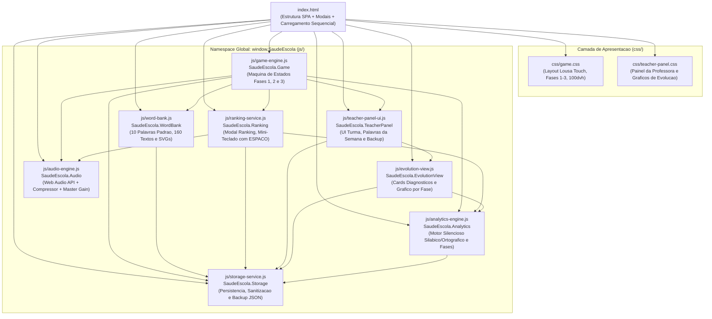
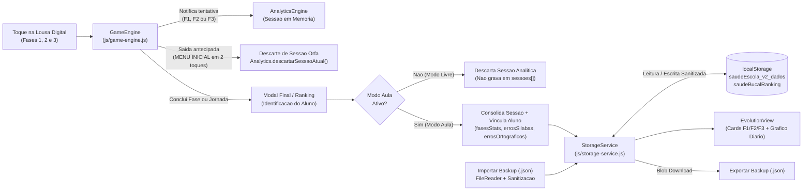

# Arquitetura de Software e Modelo de Dados (v2.2.0)

Este documento descreve a arquitetura modular **Offline-First**, o fluxo de dados pedagógicos, o modelo de persistência no `localStorage` e os mecanismos de segurança, privacidade (LGPD Escolar) e Interação Humano-Computador (IHC) implementados na versão **v2.2.0** do projeto **Saúde na Escola: Saúde Bucal**.

Para consultar o contexto histórico e as justificativas de cada decisão arquitetural, veja os **6 Mini-ADRs** documentados em [../CHANGELOG.md](../CHANGELOG.md).

---

## 1. Arquitetura Modular 100% Offline (`window.SaudeEscola`)

Para permitir que o jogo funcione com duplo clique em `index.html` diretamente pelo protocolo `file://` nos computadores da escola (sem servidor HTTP local e sem erros de política CORS causados por `<script type="module">`), toda a aplicação foi estruturada em **IIFEs (*Immediately Invoked Function Expressions*)** que registram seus submódulos sob o namespace global `window.SaudeEscola`.

### Ordem explícita de carregamento dos 20 módulos

A ordem abaixo é a ordem executada pelos elementos `<script src="...">` de [`index.html`](../index.html). Os módulos posteriores podem consultar os anteriores pelo namespace `window.SaudeEscola`.

| Ordem | Arquivo | Dependências diretas observáveis |
| ---: | --- | --- |
| 1 | `js/dom-safe.js` | Nenhuma; cria `SaudeEscola.DomSafe` |
| 2 | `js/period-service.js` | Nenhuma obrigatória; cria `SaudeEscola.Periods` |
| 3–7 | `js/stickers/animais.js`, `frutas.js`, `natureza.js`, `escola.js`, `brinquedos.js` | Nenhuma; registram dados em `SaudeEscola.StickersData` |
| 8 | `js/stickers/index.js` | `SaudeEscola.StickersData` das categorias anteriores; cria `SaudeEscola.Stickers` |
| 9 | `js/storage-service.js` | `DomSafe`, `Periods` e dados de stickers; cria `SaudeEscola.Storage` |
| 10 | `js/analytics-engine.js` | `Storage`; cria `SaudeEscola.Analytics` |
| 11 | `js/evolution-view.js` | `Storage`, `Analytics`, `DomSafe`; cria `SaudeEscola.EvolutionView` |
| 12 | `js/report-print.js` | `Storage`, `Analytics`, `Periods`, `DomSafe`; cria `SaudeEscola.ReportPrint` |
| 13 | `js/syllable-helper.js` | Nenhuma obrigatória; cria `SaudeEscola.SyllableHelper` |
| 14 | `js/teacher-panel-ui.js` | `Storage`, `Periods`, `EvolutionView`, `ReportPrint`, `SyllableHelper`, `Stickers`, `DomSafe` |
| 15 | `js/ui-icons.js` | `DomSafe`; cria `SaudeEscola.UiIcons` |
| 16 | `js/word-bank.js` | `Storage`, `Stickers`, `DomSafe`; cria `SaudeEscola.WordBank` |
| 17 | `js/mascot-controller.js` | `UiIcons` quando disponível; cria `SaudeEscola.Mascot` |
| 18 | `js/audio-engine.js` | Nenhuma obrigatória; cria `SaudeEscola.Audio` |
| 19 | `js/ranking-service.js` | `Storage`, `Analytics`, `Audio`, `DomSafe`, `TeacherPanel` |
| 20 | `js/game-engine.js` | `Storage`, `Analytics`, `WordBank`, `Ranking`, `Audio`, `TeacherPanel`, `DomSafe`, `UiIcons`, `Mascot` |

### Contratos públicos dos módulos

| Módulo | Consome | Exporta e responsabilidade |
| --- | --- | --- |
| `DomSafe` | DOM/SVG nativos | Criação segura, sanitização de atributos, SVG e utilitários de eventos. |
| `Periods` | Datas e configurações do painel | Validação ISO, geração, sanitização, filtragem e agrupamento por ciclos letivos. |
| `StickersData` e `Stickers` | Dados das cinco categorias | Catálogo de 40 figurinhas, correspondência por palavra e seleção por categoria. |
| `Storage` | `localStorage`, JSON de backup e módulos auxiliares disponíveis | Persistência, sanitização, CRUD da turma, Palavras da Semana, sessões e anotações. |
| `Analytics` | Sessões do `Storage` e eventos do `Game` | Sessão em memória, métricas por fase, comparativos, trocas ortográficas e diagnósticos. |
| `EvolutionView` | `Storage`, `Analytics`, `DomSafe` | Renderização dos cards, gráficos, períodos e visão Aluno por Aluno. |
| `ReportPrint` | `Storage`, `Analytics`, `Periods`, `DomSafe` | Resumo pedagógico imprimível/PDF offline. |
| `SyllableHelper` | Texto fornecido pela interface | Separação silábica, análise de lote e pré-visualização. |
| `TeacherPanel` | `Storage`, `Periods`, `EvolutionView`, `ReportPrint`, `SyllableHelper`, `Stickers`, `UiIcons`, `DomSafe` | Interface docente, abas, cadastro, backup, períodos e confirmações em dois toques. |
| `UiIcons` | `DomSafe` quando disponível | Catálogo central de SVGs de interface. |
| `WordBank` | `Storage`, `Stickers`, `DomSafe` | Banco nativo, Palavras da Semana, filas sem repetição e ilustrações. |
| `Mascot` | `UiIcons` quando disponível | Estados expressivos, fala, piscadas e animações do Dentinho. |
| `Audio` | Web Audio API nativa | Efeitos sonoros e cadeia dinâmica de ganho. |
| `Ranking` | `Storage`, `Analytics`, `Audio`, `DomSafe`, `TeacherPanel` | Registro, ordenação, sugestões, teclado virtual e limpeza do ranking. |
| `Game` | Todos os módulos pedagógicos e de interface necessários | Máquina de estados das fases e jornada, navegação e eventos de toque/teclado. |

### Diagrama 1 — Referência histórica da arquitetura v2.1

> **Nota:** este diagrama e a tabela seguinte registram a arquitetura histórica da v2.1 e não substituem a tabela atual dos 20 módulos da v2.2.0 apresentada acima.



### Responsabilidades dos Módulos JavaScript

| Ordem de Carga | Arquivo | Namespace | Responsabilidade Principal |
| :---: | :--- | :--- | :--- |
| **1º** | `js/storage-service.js` | `SaudeEscola.Storage` | Camada única de acesso à chave `saudeEscola_v2_dados`, validação de esquema (`sanitizarDados`), geração de distratores para Palavras da Semana e exportação/importação de Backup JSON. |
| **2º** | `js/analytics-engine.js` | `SaudeEscola.Analytics` | Captura silenciosa em memória durante as Fases 1, 2 e 3, classificação de trocas ortográficas e confusões silábicas, contabilização por fase (`fasesStats`) e agregação estatística para relatórios. |
| **3º** | `js/evolution-view.js` | `SaudeEscola.EvolutionView` | Renderização visual da Aba 3 do Painel da Professora, incluindo cards de desempenho por fase (`F1`, `F2`, `F3`) e gráfico diário de barras verticais agrupadas. |
| **4º** | `js/teacher-panel-ui.js` | `SaudeEscola.TeacherPanel` | Controle do gesto de abertura (3 segundos), gerenciamento das 3 abas do Painel da Professora, cadastro de turma, editor de Palavras da Semana e acionamento de Backup/Restauração. |
| **5º** | `js/word-bank.js` | `SaudeEscola.WordBank` | Banco padrão de Saúde Bucal (10 palavras, 80 dicas, 80 frases e SVGs vetoriais infantis), filas persistentes *Fisher-Yates* sem repetição e ponte transparente com as Palavras da Semana. |
| **6º** | `js/audio-engine.js` | `SaudeEscola.Audio` | Síntese procedural de efeitos sonoros (`playClick`, `playPop`, `playSuccess`, `playEncourage`, `playFanfare`) com `DynamicsCompressorNode` e ganho master calibrado para lousas HDMI. |
| **7º** | `js/ranking-service.js` | `SaudeEscola.Ranking` | Persistência da chave `saudeBucalRanking`, mini-teclado virtual com tecla `ESPAÇO`, chips de sugestão rápida da turma e vínculo do aluno identificado à sessão analítica recém-concluída. |
| **8º** | `js/game-engine.js` | `SaudeEscola.Game` | Máquina de estados central (`gameState`), lógica interativa das Fases 1, 2 e 3, confirmação em 2 toques no botão `MENU INICIAL` e suporte a teclado físico/touch. |

---

### Centralização documental dos limites `MAX_*`

Os limites continuam definidos localmente nos módulos nesta versão; esta tabela evita que a documentação perca o valor real das constantes atuais.

| Constante | Valor atual | Arquivo | Proteção associada |
| --- | ---: | --- | --- |
| `MAX_ALUNOS` | 100 | `storage-service.js` | Quantidade máxima de alunos da turma. |
| `MAX_ALUNO_NOME` | 60 caracteres | `storage-service.js` | Nome normalizado do aluno. |
| `MAX_PALAVRAS_SEMANA` | 12 | `storage-service.js` | Palavras personalizadas do painel docente. |
| `MAX_SESSOES` | 500 | `storage-service.js` | Histórico diagnóstico retido. |
| `MAX_ANOTACOES` | 200 | `storage-service.js` | Anotações da professora. |
| `MAX_ANOTACAO_TEXTO` | 1000 caracteres | `storage-service.js` | Texto de uma anotação. |
| `MAX_ANOTACAO_ALUNO_NOME` | 60 caracteres | `storage-service.js` | Nome associado à anotação. |
| `MAX_BACKUP_BYTES` | 2 MiB | `storage-service.js` | Tamanho máximo de Backup JSON. |
| `MAX_ID_LENGTH` | 64 caracteres | `storage-service.js` | Identificadores sanitizados. |
| `MAX_MAP_KEYS` | 80 | `storage-service.js` | Chaves preservadas em mapas analíticos sanitizados. |
| `MAX_PALAVRAS_TRABALHADAS_SESSAO` | 50 | `storage-service.js` | Vocabulário registrado por sessão. |
| `MAX_PALAVRA_LETRAS` | 30 | `storage-service.js` | Palavra construída na aba personalizada. |
| `MAX_PALAVRA_SILABAS` | 12 | `storage-service.js` | Quantidade máxima de sílabas personalizadas. |
| `MAX_RANKING_ENTRIES` | 30 | `ranking-service.js` | Entradas exibidas e persistidas no ranking. |
| `MAX_RANKING_BACKUP_ENTRIES` | 30 | `storage-service.js` | Entradas preservadas na sanitização de ranking usada pelo backup. |
| `MAX_NAME_LENGTH` / `MAX_RANKING_NAME_LENGTH` | 18 caracteres | `ranking-service.js` / `storage-service.js` | Nome informado no ranking. |
| `MIN_ANO` | 2000 | `period-service.js` | Ano mínimo dos períodos letivos. |
| `MAX_ANO` | 2100 | `period-service.js` | Ano máximo dos períodos letivos. |
| `MAX_CICLOS` | 6 | `period-service.js` | Quantidade máxima aceita em uma configuração sanitizada. |
| `MAX_NOME_LEN` | 40 caracteres | `period-service.js` | Nome completo do período/ciclo. |
| `MAX_SIGLA_LEN` | 16 caracteres | `period-service.js` | Sigla do período/ciclo. |
| `MAX_ID_LEN` | 32 caracteres | `period-service.js` | Identificador do período/ciclo. |

---

## 2. Fluxo de Dados Pedagógicos e Ciclo de Vida da Sessão

O diagrama a seguir detalha o caminho percorrido pelos eventos de interação na lousa digital até a consolidação no `localStorage`, a visualização no gráfico de evolução por fase e a portabilidade via arquivo JSON, destacando as barreiras de descarte no **Modo Livre** e em **sessões órfãs**.

### Diagrama 2 — Fluxo de Dados do Toque na Lousa ao Gráfico e Backup JSON



---

## 3. Modelo de Dados (`localStorage`)

A aplicação utiliza o `localStorage` do navegador de forma particionada para garantir retrocompatibilidade entre as versões `v1.x`, `v2.1.x` e `v2.2.0`:

### 3.1. Chave Principal: `saudeEscola_v2_dados`
Armazena as configurações do Painel da Professora, a lista de alunos da turma, o banco personalizado de Palavras da Semana e até **500 sessões diagnósticas** (`MAX_SESSOES = 500`).

```json
{
  "versao": 2,
  "config": {
    "modo": "aula",
    "palavrasSemanaAtivo": true,
    "fase1ModoSemana": "dica",
    "periodosLetivos": {
      "modelo": "bimestre",
      "ano": 2026,
      "ciclos": []
    }
  },
  "turma": [
    {
      "id": "alu_m3k9x_1a2b3",
      "nome": "Ana J.",
      "chave": "ana j."
    }
  ],
  "palavrasSemana": [
    {
      "id": "pal_m3k9z_2c4d5",
      "palavra": "ESCOVA",
      "plain": "ESCOVA",
      "silabasRaw": "ES-CO-VA",
      "silabas": ["ES", "CO", "VA"],
      "dica": "USAMOS COM PASTA PARA LIMPAR OS DENTES.",
      "frase": "EU USO A ___ APÓS AS REFEIÇÕES.",
      "stickerId": "escova"
    }
  ],
  "sessoes": [
    {
      "id": "sessao_1732140000000_x8k2p",
      "dataISO": "2026-11-20",
      "timestamp": 1732140000000,
      "finalizadaEm": 1732140180000,
      "alunoId": "alu_m3k9x_1a2b3",
      "alunoNome": "ANA J.",
      "alunoChave": "ana j.",
      "modoJogo": "JOURNEY",
      "fontePalavras": "SEMANA",
      "tentativas": 14,
      "acertos": 12,
      "acertosPrimeira": 10,
      "atividadesRegistradas": 14,
      "fasesStats": {
        "fase1": { "tentativas": 5, "acertos": 4, "acertosPrimeira": 3, "tempoSegundos": 12.5, "rodadas": 1 },
        "fase2": { "tentativas": 4, "acertos": 4, "acertosPrimeira": 4 },
        "fase3": { "tentativas": 5, "acertos": 4, "acertosPrimeira": 3 }
      },
      "errosSilabas": {
        "GUA": {
          "count": 1,
          "palavras": ["ÁGUA"],
          "confusoes": { "GA": 1 }
        }
      },
      "errosOrtograficos": {
        "TROCA_G_J": {
          "codigo": "TROCA_G_J",
          "label": "Troca G / J",
          "count": 1,
          "exemplos": ["GENGIVA (J no lugar de G)"]
        }
      },
      "palavrasStats": {
        "GENGIVA": { "tentativas": 2, "acertos": 1, "erros": 1 }
      },
      "palavrasTrabalhadas": ["ESCOVA", "GENGIVA", "ÁGUA", "DENTE"]
    }
  ],
  "anotacoes": []
}
```

> **Nota de Retrocompatibilidade (`fasesStats`):** Em sessões gravadas antes da introdução do diagnóstico por fase (v2.0), a função `sanitizarFasesStats()` preserva `fasesStats: null`. O `AnalyticsEngine` contabiliza essas sessões normalmente nas métricas gerais da turma, enquanto os cards específicos de Fase 1, 2 e 3 exibem `Sem registros` apenas quando nenhuma sessão do filtro selecionado possuir dados daquela fase.

### 3.2. Chave do Ranking: `saudeBucalRanking`
Armazena até **30 registros** (`MAX_RANKING_ENTRIES = 30`) ordenados de forma decrescente por número de estrelas (`stars`) e desempatados pela data (`date`) mais recente:

```json
[
  {
    "name": "ANA J.",
    "stars": 15,
    "mode": "JORNADA COMPLETA",
    "date": 1732140185000
  }
]
```

### 3.3. Chaves Auxiliares de Filas Sem Repetição (*Fisher-Yates*)
Gerenciadas por `js/word-bank.js` para garantir que nenhuma dica ou frase do banco padrão se repita antes que todas as 8 variações de cada palavra tenham sido exibidas:
- `saudeBucalClueQueues`: Mapa de índices embaralhados `[0..7]` por palavra para a Fase 2.
- `saudeBucalSentenceQueues`: Mapa de índices embaralhados `[0..7]` por palavra para a Fase 3.

---

## 4. Garantias de Segurança, LGPD Escolar e IHC

As diretrizes abaixo consolidam as práticas de engenharia auditadas até a v2.2.0 (detalhadas nos Mini-ADRs em [../CHANGELOG.md](../CHANGELOG.md)):

### 4.1. Prevenção Estrita contra XSS e Sanitização de Schema
- **Barreira na Persistência (`ADR-03`):** Todo dado lido do `localStorage` ou carregado via upload de arquivo JSON (`Storage.importarBackupJSON`) atravessa obrigatoriamente os sanitizadores `sanitizarDados()` e `sanitizarListaRanking()`. Tipos inválidos são descartados, números negativos são normalizados por `sanitizarNumeroNaoNegativo()` e palavras personalizadas são revalidadas por `validarDadosPalavra()`.
- **Barreira na Renderização DOM:** Os módulos de interface (`teacher-panel-ui.js`, `evolution-view.js` e `ranking-service.js`) utilizam `SaudeEscola.DomSafe` para criar elementos com `textContent`, `createElement` e `createElementNS`, e para sanitizar SVG antes da renderização.

### 4.2. LGPD Escolar e Integridade dos Dados Analíticos (`ADR-06`)
- **Armazenamento 100% Local-First:** Nenhum dado pessoal ou desempenho pedagógico é enviado pela rede. A portabilidade entre máquinas ocorre exclusivamente sob controle físico da professora via arquivo JSON de backup.
- **Minimização de Dados (`Nome + Inicial`):** Os campos de cadastro individual e em lote orientam o registro apenas do primeiro nome seguido da inicial do sobrenome (ex.: `Ana J.`), e o mini-teclado virtual do Ranking inclui a tecla `ESPAÇO` para permitir essa grafia diretamente na lousa digital.
- **Eliminação de Sessões Órfãs:** Partidas interrompidas no meio pelo botão `MENU INICIAL` acionam `Analytics.descartarSessaoAtual()`, garantindo que apenas partidas efetivamente concluídas componham as estatísticas da turma.

### 4.3. IHC para Lousa Digital Touch e Áudio Escolar (`ADR-04` e `ADR-05`)
- **Confirmação em 2 Toques (Zero Modais Nativos Bloqueantes):** Ações destrutivas exigem dois toques consecutivos dentro de uma janela de tempo (3,2s a 3,5s), alterando o rótulo e o estilo visual do próprio botão no primeiro toque (ex.: `TOQUE NOVAMENTE PARA SAIR` ou `TOQUE NOVAMENTE PARA ZERAR`). Isso protege contra esbarrões de mão na base da lousa sem usar `window.confirm()`, que trava o loop de eventos touch em navegadores de tela cheia.
- **Proteção contra Toque Fantasma em Modais:** A abertura de modais sobrepostos utiliza bloqueio temporário de eventos e verificação de início de clique no *backdrop* (`backdropPressStarted`), evitando fechamentos acidentais ao soltar o dedo na lousa.
- **Cadeia de Áudio com Compressor Dinâmico:** O módulo `SaudeEscola.Audio` roteia todos os osciladores por um `DynamicsCompressorNode` antes do `GainNode` master (`1.35`), elevando a percepção sonora em salas de aula com 25 crianças sem saturar a saída HDMI nos acordes de múltiplas notas.

---

## 5. Roteiro Modular da v2.3

Nesta versão a divisão em 20 IIFEs continua intencionalmente preservada para manter compatibilidade com `file://` e não exigir bundler. Na v2.3, a evolução modular deverá ser adotada em etapas independentes, sem renomear APIs já consumidas pela versão instalada:

1. Extrair serviços de dados de `storage-service.js`: turma, Palavras da Semana, sessões, anotações e backup.
2. Separar a interface do Painel da Professora por abas, mantendo `SaudeEscola.TeacherPanel` como fachada pública estável.
3. Dividir a lógica pedagógica de `game-engine.js` por máquina de estado, carregamento de palavras e registro analítico.
4. Separar visualização e cálculo em `evolution-view.js`, preservando `SaudeEscola.EvolutionView.render`.
5. Consolidar contratos de módulos auxiliares e fallback em um manifesto interno, sem introduzir ES Modules nem dependências externas.
6. Somente após estabilizar esses contratos, avaliar arquivos menores para temas, calendário escolar e arquitetura multi-turma da v3.0.
