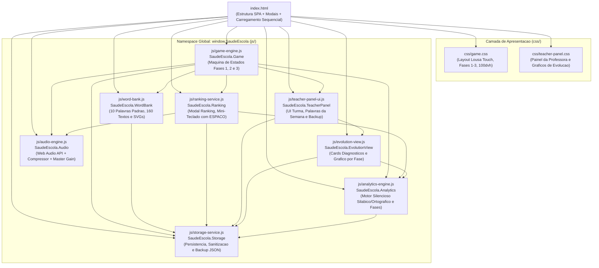
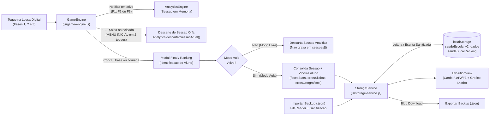

# Arquitetura de Software e Modelo de Dados (v2.1)

Este documento descreve a arquitetura modular **Offline-First**, o fluxo de dados pedagógicos, o modelo de persistência no `localStorage` e os mecanismos de segurança, privacidade (LGPD Escolar) e Interação Humano-Computador (IHC) implementados na versão **v2.1** do projeto **Saúde na Escola: Saúde Bucal**.

Para consultar o contexto histórico e as justificativas de cada decisão arquitetural, veja os **6 Mini-ADRs** documentados em [../CHANGELOG.md](../CHANGELOG.md).

---

## 1. Arquitetura Modular 100% Offline (`window.SaudeEscola`)

Para permitir que o jogo funcione com duplo clique em `index.html` diretamente pelo protocolo `file://` nos computadores da escola (sem servidor HTTP local e sem erros de política CORS causados por `<script type="module">`), toda a aplicação foi estruturada em **IIFEs (*Immediately Invoked Function Expressions*)** que registram seus submódulos sob o namespace global `window.SaudeEscola`.

### Diagrama 1 — Orquestração Modular sob `window.SaudeEscola`



### Responsabilidades dos Módulos JavaScript

| Ordem de Carga | Arquivo | Namespace | Responsabilidade Principal |
| :---: | :--- | :--- | :--- |
| **1º** | `js/storage-service.js` | `SaudeEscola.Storage` | Camada única de acesso à chave `saudeEscola_v2_dados`, validação de esquema (`sanitizarDados`), geração de distratores para Palavras da Semana e exportação/importação de Backup JSON. |
| **2º** | `js/analytics-engine.js` | `SaudeEscola.Analytics` | Captura silenciosa em memória durante as Fases 1, 2 e 3, classificação de trocas ortográficas e confusões silábicas, contabilização por fase (`fasesStats`) e agregação estatística para relatórios. |
| **3º** | `js/evolution-view.js` | `SaudeEscola.EvolutionView` | Renderização visual da Aba 3 do Painel da Professora, incluindo cards de desempenho por fase (`F1`, `F2`, `F3`) e gráfico diário de barras verticais agrupadas. |
| **4º** | `js/teacher-panel-ui.js` | `SaudeEscola.TeacherPanel` | Controle do gesto de abertura (3 segundos), gerenciamento das 3 abas do Painel da Professora, cadastro de turma, editor de Palavras da Semana e acionamento de Backup/Restauração. |
| **5º** | `js/word-bank.js` | `SaudeEscola.WordBank` | Banco padrão de Saúde Bucal (10 palavras, 80 dicas, 80 frases e SVGs vetoriais infantis), filas persistentes *Fisher-Yates* sem repetição e ponte transparente com as Palavras da Semana. |
| **6º** | `js/audio-engine.js` | `SaudeEscola.Audio` | Síntese procedural de efeitos sonoros (`playClick`, `playPop`, `playSuccess`, `playEncourage`, `playFanfare`) com `DynamicsCompressorNode` e ganho master calibrado para lousas HDMI. |
| **7º** | `js/ranking-service.js` | `SaudeEscola.Ranking` | Persistência da chave `saudeBucalRanking`, mini-teclado virtual com tecla `ESPAÇO`, chips de sugestão rápida da turma e vínculo do aluno identificado à sessão analítica recém-concluída. |
| **8º** | `js/game-engine.js` | `SaudeEscola.Game` | Máquina de estados central (`gameState`), lógica interativa das Fases 1, 2 e 3, confirmação em 2 toques no botão `MENU INICIAL` e suporte a teclado físico/touch. |

---

## 2. Fluxo de Dados Pedagógicos e Ciclo de Vida da Sessão

O diagrama a seguir detalha o caminho percorrido pelos eventos de interação na lousa digital até a consolidação no `localStorage`, a visualização no gráfico de evolução por fase e a portabilidade via arquivo JSON, destacando as barreiras de descarte no **Modo Livre** e em **sessões órfãs**.

### Diagrama 2 — Fluxo de Dados do Toque na Lousa ao Gráfico e Backup JSON



---

## 3. Modelo de Dados (`localStorage`)

A aplicação utiliza o `localStorage` do navegador de forma particionada para garantir retrocompatibilidade entre as versões `v1.x` e `v2.1`:

### 3.1. Chave Principal: `saudeEscola_v2_dados`
Armazena as configurações do Painel da Professora, a lista de alunos da turma, o banco personalizado de Palavras da Semana e até **500 sessões diagnósticas** (`MAX_SESSOES = 500`).

```json
{
  "versao": 2,
  "config": {
    "modo": "aula",
    "palavrasSemanaAtivo": true,
    "fase1ModoSemana": "dica"
  },
  "turma": [
    {
      "id": "alu_m3k9x_1a2b3",
      "nome": "Ana J.",
      "chave": "ana j."
    }
  ],
  "palavrasSemana": [
    {
      "id": "pal_m3k9z_2c4d5",
      "palavra": "ESCOVA",
      "plain": "ESCOVA",
      "silabasRaw": "ES-CO-VA",
      "silabas": ["ES", "CO", "VA"],
      "dica": "USAMOS COM PASTA PARA LIMPAR OS DENTES.",
      "frase": "EU USO A ___ APÓS AS REFEIÇÕES."
    }
  ],
  "sessoes": [
    {
      "id": "sessao_1732140000000_x8k2p",
      "dataISO": "2026-11-20",
      "timestamp": 1732140000000,
      "finalizadaEm": 1732140180000,
      "alunoId": "alu_m3k9x_1a2b3",
      "alunoNome": "ANA J.",
      "alunoChave": "ana j.",
      "modoJogo": "JOURNEY",
      "fontePalavras": "SEMANA",
      "tentativas": 14,
      "acertos": 12,
      "acertosPrimeira": 10,
      "atividadesRegistradas": 14,
      "fasesStats": {
        "fase1": { "tentativas": 5, "acertos": 4, "acertosPrimeira": 3 },
        "fase2": { "tentativas": 4, "acertos": 4, "acertosPrimeira": 4 },
        "fase3": { "tentativas": 5, "acertos": 4, "acertosPrimeira": 3 }
      },
      "errosSilabas": {
        "GUA": {
          "count": 1,
          "palavras": ["ÁGUA"],
          "confusoes": { "GA": 1 }
        }
      },
      "errosOrtograficos": {
        "TROCA_G_J": {
          "codigo": "TROCA_G_J",
          "label": "Troca G / J",
          "count": 1,
          "exemplos": ["GENGIVA (J no lugar de G)"]
        }
      },
      "palavrasStats": {
        "GENGIVA": { "tentativas": 2, "acertos": 1, "erros": 1 }
      },
      "palavrasTrabalhadas": ["ESCOVA", "GENGIVA", "ÁGUA", "DENTE"]
    }
  ]
}
```

> **Nota de Retrocompatibilidade (`fasesStats`):** Em sessões gravadas antes da introdução do diagnóstico por fase (v2.0), a função `sanitizarFasesStats()` preserva `fasesStats: null`. O `AnalyticsEngine` contabiliza essas sessões normalmente nas métricas gerais da turma, enquanto os cards específicos de Fase 1, 2 e 3 exibem `Sem registros` apenas quando nenhuma sessão do filtro selecionado possuir dados daquela fase.

### 3.2. Chave do Ranking: `saudeBucalRanking`
Armazena até **30 registros** (`MAX_RANKING_ENTRIES = 30`) ordenados de forma decrescente por número de estrelas (`stars`) e desempatados por `timestamp` mais recente:

```json
[
  {
    "name": "ANA J.",
    "stars": 15,
    "mode": "JORNADA COMPLETA",
    "timestamp": 1732140185000
  }
]
```

### 3.3. Chaves Auxiliares de Filas Sem Repetição (*Fisher-Yates*)
Gerenciadas por `js/word-bank.js` para garantir que nenhuma dica ou frase do banco padrão se repita antes que todas as 8 variações de cada palavra tenham sido exibidas:
- `saudeBucalClueQueues`: Mapa de índices embaralhados `[0..7]` por palavra para a Fase 2.
- `saudeBucalSentenceQueues`: Mapa de índices embaralhados `[0..7]` por palavra para a Fase 3.

---

## 4. Garantias de Segurança, LGPD Escolar e IHC

As diretrizes abaixo consolidam as práticas de engenharia auditadas na versão **v2.1** (detalhadas nos Mini-ADRs em [../CHANGELOG.md](../CHANGELOG.md)):

### 4.1. Prevenção Estrita contra XSS e Sanitização de Schema
- **Barreira na Persistência (`ADR-03`):** Todo dado lido do `localStorage` ou carregado via upload de arquivo JSON (`Storage.importarBackupJSON`) atravessa obrigatoriamente os sanitizadores `sanitizarDados()` e `sanitizarListaRanking()`. Tipos inválidos são descartados, números negativos são normalizados por `sanitizarNumeroNaoNegativo()` e palavras personalizadas são revalidadas por `validarDadosPalavra()`.
- **Barreira na Renderização DOM:** Os módulos de interface (`teacher-panel-ui.js`, `evolution-view.js` e `ranking-service.js`) utilizam funções dedicadas de escape (`escapeHtml` / `escapeHtmlSafe`) para converter `&`, `<`, `>`, `"` e `'` em entidades HTML seguras antes de qualquer interpolação de template, ou utilizam `textContent` diretamente na criação de nós DOM.

### 4.2. LGPD Escolar e Integridade dos Dados Analíticos (`ADR-06`)
- **Armazenamento 100% Local-First:** Nenhum dado pessoal ou desempenho pedagógico é enviado pela rede. A portabilidade entre máquinas ocorre exclusivamente sob controle físico da professora via arquivo JSON de backup.
- **Minimização de Dados (`Nome + Inicial`):** Os campos de cadastro individual e em lote orientam o registro apenas do primeiro nome seguido da inicial do sobrenome (ex.: `Ana J.`), e o mini-teclado virtual do Ranking inclui a tecla `ESPAÇO` para permitir essa grafia diretamente na lousa digital.
- **Eliminação de Sessões Órfãs:** Partidas interrompidas no meio pelo botão `MENU INICIAL` acionam `Analytics.descartarSessaoAtual()`, garantindo que apenas partidas efetivamente concluídas componham as estatísticas da turma.

### 4.3. IHC para Lousa Digital Touch e Áudio Escolar (`ADR-04` e `ADR-05`)
- **Confirmação em 2 Toques (Zero Modais Nativos Bloqueantes):** Ações destrutivas exigem dois toques consecutivos dentro de uma janela de tempo (3,2s a 3,5s), alterando o rótulo e o estilo visual do próprio botão no primeiro toque (ex.: `TOQUE NOVAMENTE PARA SAIR` ou `TOQUE NOVAMENTE PARA ZERAR`). Isso protege contra esbarrões de mão na base da lousa sem usar `window.confirm()`, que trava o loop de eventos touch em navegadores de tela cheia.
- **Proteção contra Toque Fantasma em Modais:** A abertura de modais sobrepostos utiliza bloqueio temporário de eventos e verificação de início de clique no *backdrop* (`backdropPressStarted`), evitando fechamentos acidentais ao soltar o dedo na lousa.
- **Cadeia de Áudio com Compressor Dinâmico:** O módulo `SaudeEscola.Audio` roteia todos os osciladores por um `DynamicsCompressorNode` antes do `GainNode` master (`1.35`), elevando a percepção sonora em salas de aula com 25 crianças sem saturar a saída HDMI nos acordes de múltiplas notas.
