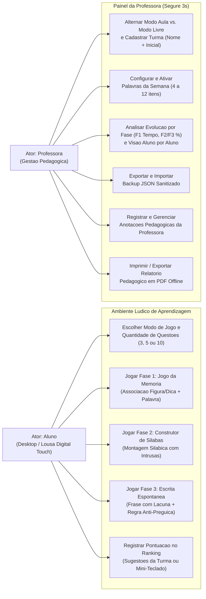

# Especificação de Requisitos de Software (v2.2.0)

Este documento especifica os atores, os Requisitos Funcionais (`RF`), os Requisitos Não-Funcionais (`RNF`), as Regras de Negócio (`RN`) e o modelo de interação do software educativo **Saúde na Escola: Saúde Bucal**, desenvolvido com **foco principal em Desktop e Lousas Digitais (Windows, macOS e Linux)** e mantendo suporte mobile secundário para visualização de demonstração.

---

## 1. Atores do Sistema

| Ator | Perfil e Contexto de Operação | Responsabilidades e Interações Principais |
| :--- | :--- | :--- |
| **Aluno** | Criança do Ensino Fundamental I (6 a 7 anos, 1º e 2º anos) interagindo em **Desktop ou Lousa Digital Touch** (Windows, macOS ou Linux) em sala de aula, ou visitante durante a Mostra Escolar (incluindo visualização mobile de demonstração). | Selecionar modo de jogo e quantidade de questões; interagir com o mascote Dentinho; jogar as Fases 1 (Memória), 2 (Sílabas) e 3 (Escrita); registrar seu nome no Ranking ao concluir a partida utilizando sugestões da turma ou o mini-teclado virtual. |
| **Professora** | Docente regente da turma (especialista pedagógica) operando a lousa digital ou computador da sala antes e após as atividades. | Acessar o Painel da Professora por gesto de proteção (3 segundos); alternar entre Modo Aula e Modo Livre; cadastrar alunos (`Nome + Inicial`); configurar e ativar as "Palavras da Semana"; analisar evolução por fase e aluno por aluno; registrar anotações pedagógicas; exportar relatórios em PDF offline e restaurar backups em JSON. |

---

## 2. Diagrama de Casos de Uso e Interações

O diagrama abaixo ilustra as fronteiras de interação entre o **Aluno** e a **Professora** nos módulos da aplicação:

---

## 3. Requisitos Funcionais (RF)

| Código | Título | Descrição Técnica e Comportamental |
| :--- | :--- | :--- |
| **RF01** | Seleção de Modos de Jogo e Quantidade de Questões | No Menu Inicial, o sistema deve permitir iniciar a **Jornada Completa** (Fases 1, 2 e 3 em sequência) ou qualquer fase individualmente, além de selecionar a quantidade de questões para as Fases 2 e 3 entre **3, 5 ou 10 questões** (ajustando-se automaticamente ao limite disponível quando o modo Palavras da Semana possuir menos de 10 itens). |
| **RF02** | Fase 1 — Jogo da Memória com Exigência de Leitura | O sistema deve sortear 4 palavras por rodada (8 cartas) e formar cada par com **1 carta de estímulo visual/contextual** (ilustração SVG no banco padrão; dica/frase ou sílaba inicial no modo Palavras da Semana) e **1 carta contendo exclusivamente a palavra escrita em caixa alta**, exigindo leitura ativa para formar os pares. |
| **RF03** | Fase 2 — Construtor de Sílabas com Distratores | O sistema deve exibir uma dica textual (sorteada sem repetição de uma fila embaralhada via *Fisher-Yates* com 80 dicas no banco padrão) e disponibilizar na metade inferior da tela os espaços vazios da palavra junto às sílabas corretas embaralhadas com **2 sílabas intrusas**. Ao errar a palavra completa, apenas as sílabas incorretas devem retornar à área inferior. |
| **RF04** | Fase 3 — Escrita Espontânea com Regra Anti-Preguiça | O sistema deve exibir uma frase com lacuna (80 frases no banco padrão), caixas de letras e teclado virtual próprio (`A-Z`, `APAGAR`, `VERIFICAR`). Ao verificar a tentativa, o sistema deve aplicar normalização Unicode (`NFD`) para aceitar vogais sem acento, travar em verde as letras posicionadas corretamente e limpar apenas as letras incorretas (**Regra Anti-Preguiça**). |
| **RF05** | Sistema de Pontuação Visual e Ranking da Turma | O sistema deve contabilizar estrelas em escala numérica baixa apropriada ao 1º e 2º anos, exibir o modal de celebração ao final da partida e permitir o registro do aluno no Ranking ordenado de forma decrescente (do maior para o menor) com medalhas vetoriais para os 3 primeiros lugares. |
| **RF06** | Mini-Teclado Virtual com Tecla `ESPAÇO` e Sugestões Rápidas | No registro do Ranking, o sistema deve disponibilizar mini-teclado virtual contendo as letras `A-Z`, a tecla `ESPAÇO` (para nomes compostos com inicial) e o botão `APAGAR`. Quando o **Modo Aula** estiver ativo e houver alunos cadastrados, deve exibir chips de sugestão rápida para seleção com um toque. |
| **RF07** | Acesso Protegido ao Painel da Professora | O botão de engrenagem no Menu Inicial deve exigir pressão contínua de **3 segundos** (`3000ms`) para abrir o modal do Painel da Professora, impedindo que alunos acessem configurações acidentalmente durante o uso na lousa. |
| **RF08** | Gestão da Turma e Chaveamento Modo Aula vs. Modo Livre | Na Aba 1 do Painel da Professora (*Turma e Modo*), o sistema deve permitir alternar entre **Modo Aula** e **Modo Livre**, além de adicionar alunos (individualmente ou em lote separados por vírgula/linha) e remover alunos cadastrados. |
| **RF09** | Configuração Ágil de "Palavras da Semana" com Silabação Automática e Figurinhas | Na Aba 2 do Painel da Professora (*Palavras da Semana*), o sistema deve exibir cartão de progresso rumo ao mínimo de **4 palavras** (máximo 12, até 30 letras e 12 sílabas por palavra), separar automaticamente as sílabas em Português (`SyllableHelper`) com pré-visualização em blocos táteis e ajuste manual, permitir cadastro em lote (vírgula, ponto e vírgula ou linha) e associar automaticamente ou via galeria uma das **40 figurinhas vetoriais infantis em 5 categorias** (`Stickers`), além de escolher o modo da Fase 1 (*Figurinha/Dica curta* ou *Sempre a 1ª sílaba*) e aplicar fallback automático na Fase 3 (*Frase com lacuna -> Dica -> Ditado*). |
| **RF10** | Captura Diagnóstica Silenciosa, Tempo na Fase 1 e Alinhador LCS (`AnalyticsEngine`) | Durante partidas no **Modo Aula**, o sistema deve registrar silenciosamente em memória o **tempo de conclusão da rodada (em segundos)** na Fase 1 (sem penalizar cartas viradas), e cada tentativa nas Fases 2 e 3, classificando erros silábicos e aplicando alinhamento por distância de edição / LCS (`analisarEscritaFase3`) na Fase 3 para isolar omissões em dígrafos (`OMISSAO_DIGRAFO_RR/SS/CH/LH/NH/QU/GU`), `DUPLICACAO_LETRA`, `LETRAS_FALTANDO`, `LETRAS_EXTRAS` e 9 pares fonéticos/ortográficos (`TROCA_G_J`, `TROCA_M_N`, `TROCA_S_Z`, `TROCA_C_S`, `TROCA_P_B`, `TROCA_T_D`, `TROCA_F_V`, `TROCA_L_U`, `TROCA_C_G`). |
| **RF11** | Painel, Comparativo por Período Letivo e Visão Aluno por Aluno | Na Aba 3 do Painel da Professora (*Evolução e Dificuldades*), o sistema deve permitir alternar o agrupamento entre **Por Dia** e **Por Período Letivo** (**Bimestres — 4 períodos** ou **Trimestres — 3 períodos**, com datas editáveis sem sobreposição via `PeriodService`), exibindo filtros por aluno e por data/período, comparativo longitudinal, **cards separados por fase (Fase 1 por tempo médio; Fases 2 e 3 por % de acertos)**, gráfico de barras agrupadas, ranking de dificuldades e tabela panorâmica **Aluno por Aluno**. |
| **RF12** | Exportação e Importação de Backup JSON Sanitizado | Na Aba 1 do Painel da Professora, o sistema deve permitir exportar todos os dados locais (`saudeEscola_v2_dados` — incluindo `config.periodosLetivos`, `turma`, `palavrasSemana` com `stickerId`, `sessoes` e `anotacoes` — e `saudeBucalRanking`) para um arquivo `.json` via `Blob` e restaurar um arquivo `.json` via `FileReader` (validando `file.size <= 2 MB` antes da leitura), aplicando validação de esquema, proteção anti-prototype pollution e sanitização completas antes da gravação. |
| **RF13** | Anotações Pedagógicas da Professora | Na Aba 3 do Painel da Professora, o sistema deve permitir criar, editar e remover observações pedagógicas vinculadas à *Turma geral* ou a um aluno específico, persistidas localmente com sanitização XSS, confirmação em 2 toques na remoção e incluídas no Backup JSON e no Relatório PDF. |
| **RF14** | Relatório Pedagógico Imprimível / PDF Offline | Nas Abas 1 e 3 do Painel da Professora, o sistema deve disponibilizar botão para gerar relatório pedagógico formatado em folha A4 (`@media print`) 100% offline, respeitando o recorte de período letivo e o filtro de aluno individual (ou turma completa), exibindo indicadores por fase, comparativo entre períodos, principais dificuldades, tabela **Aluno por Aluno** e **Anotações da Professora**. |
| **RF15** | Mascote Interativo Falante (`Dentinho`) e Catálogo `UiIcons` | O sistema deve exibir o mascote vetorial **Dentinho** como guia no Menu Inicial (voz única) e companheiro no rodapé das fases, com piscadas orgânicas, 5 estados expressivos (`is-waving`, `is-celebrating`, `is-triumph`, `is-encouraging`, `is-curious`) e 3 cadências de boca animada (`.is-talking`, `.is-talking-excited`, `.is-talking-calm`), além de renderizar os 10 ícones vetoriais redesenhados (`UiIcons`) via `DomSafe.parseSvg`. |

---

## 4. Requisitos Não-Funcionais (RNF)

| Código | Categoria | Especificação e Critério de Aceitação |
| :--- | :--- | :--- |
| **RNF01** | Portabilidade e Execução 100% Offline (`file://`) | A aplicação deve funcionar integralmente sem conexão com a internet e sem servidor HTTP local, abrindo diretamente via protocolo `file://`. É proibido o uso de ES Modules (`import`/`export`) ou chamadas `fetch()` para arquivos locais que violem políticas de CORS em `file://`. |
| **RNF02** | Padronização Visual 100% SVG (Zero Emojis Nativos) | É estritamente proibida a utilização de caracteres emoji Unicode do sistema operacional em qualquer tela, botão, feedback ou script. Todos os elementos gráficos devem ser renderizados por código vetorial `<svg>` infantil embutido, sem `<defs>` ou `id` interno duplicado entre instâncias. |
| **RNF03** | Segurança Estrita contra XSS e CSP Offline (`DomSafe`) | A aplicação deve operar sob `Content-Security-Policy` estrito (`default-src 'none'; script-src 'self'; style-src 'self'; img-src 'self' data:; ...`) sem handlers inline (`on*=`), sem atributos `style=` inline, sem `innerHTML`/`outerHTML`/`eval()`, utilizando `window.SaudeEscola.DomSafe` e dicionários `Object.create(null)` imunes a *prototype pollution*. |
| **RNF04** | Privacidade e LGPD Escolar (Local-First) | O sistema não deve transmitir dados de alunos para servidores externos. Toda a persistência ocorre localmente no navegador da escola, orientando nos campos de cadastro o padrão **Nome + Inicial** (ex.: `Ana J.`, `Pedro M.`) para minimizar a exposição de dados pessoais na tela compartilhada da sala. |
| **RNF05** | Ergonomia de Lousa Digital Touch e Confirmação em 2 Toques | Todos os controles interativos das fases devem concentrar-se na metade inferior da tela (`.lower-zone`) para alcance de crianças de 6 a 7 anos, operando exclusivamente por toque simples (sem *drag-and-drop*). Toda ação destrutiva (`MENU INICIAL` em partida ativa, `ZERAR RANKING`, exclusão de aluno/anotação, limpeza de palavras e histórico) deve exigir **confirmação em 2 toques rápidos** com reversão automática por temporizador, sem utilizar `alert()` ou `confirm()` nativos. |
| **RNF06** | Amplificação Segura de Áudio (`Web Audio API`) | Os efeitos sonoros devem ser sintetizados proceduralmente via `AudioContext` (sem arquivos `.mp3`/`.wav` externos), passando por uma cadeia master composta por um `DynamicsCompressorNode` (`threshold: -18dB`, `knee: 12`, `ratio: 6`) conectado a um `GainNode` master (`1.35`), garantindo volume audível em TVs/lousas HDMI sem distorção harmônica. |
| **RNF07** | Desempenho e Compatibilidade Cross-Browser (Desktop e Lousas) | A aplicação deve rodar com fluidez em **Desktop e Lousas Digitais** (`> 1024px`) em **Windows, macOS e Linux** nos navegadores Chrome, Edge, Firefox e Safari, utilizando seletores DOM enxutos, `transform-box: fill-box` com `transform-origin` percentual para animações SVG consistentes, respeito a `prefers-reduced-motion: reduce` e zero bibliotecas ou *frameworks* externos em tempo de execução. |
| **RNF08** | Visualização Secundária Mobile (Demonstração) sem Regressão na Lousa | A interface mantém suporte responsivo fluido secundário para demonstração em smartphones **iOS (Safari)** e **Android (Chrome)** (`360px` a `430px+`), com `viewport-fit=cover` + `env(safe-area-inset-*)`, `font-size >= 16px` em campos de formulário e rolagem segura em modais — mantendo o foco principal e **0% de regressão** em Desktop e Lousas Digitais (`> 1024px`). |

---

## 5. Regras de Negócio (RN)

| Código | Regra de Negócio | Comportamento no Sistema |
| :--- | :--- | :--- |
| **RN01** | Isolamento Estrito do Modo Livre | Quando o sistema estiver configurado em **Modo Livre** (`config.modo === 'livre'`), nenhuma sessão de jogo deve ser persistida na lista `sessoes` do `localStorage`, e a barra de sugestões com os nomes da turma no modal do Ranking deve permanecer oculta. |
| **RN02** | Descarte Automático de Sessões Órfãs | Caso o aluno ou a professora abandone uma partida em andamento acionando a saída para o `MENU INICIAL` (após a confirmação em 2 toques) antes de concluir a fase ou jornada, a sessão analítica em memória deve ser imediatamente descartada (`Analytics.descartarSessao()`), evitando a gravação de registros incompletos sem identificação de aluno. |
| **RN03** | Mínimo Pedagógico para Ativação das Palavras da Semana | O modo **Palavras da Semana** somente pode permanecer ativo para as partidas quando houver pelo menos **4 palavras válidas** cadastradas (requisito mínimo para formar os 4 pares distintos da grade de 8 cartas na Fase 1). Se o total cair abaixo de 4 itens, o sistema desativa a flag `palavrasSemanaAtivo` e faz *fallback* automático e transparente para o banco padrão de Saúde Bucal. |
| **RN04** | Retrocompatibilidade e Limite Circular do Banco Local | O módulo `Storage` deve preservar até **500 sessões** (`MAX_SESSOES = 500`) e **200 anotações** (`MAX_ANOTACOES = 200`), descartando as mais antigas quando o limite for atingido. Sessões legadas sem `fasesStats` ou sem `rodadas`/`tempoSegundos` na Fase 1 devem permanecer legíveis e exibidas normalmente nos painéis sem gerar `NaN` ou falhas de renderização. |
| **RN05** | Desambiguação de Cartas no Modo Sílaba Inicial (Fase 1) | Quando o modo Palavras da Semana estiver configurado para parear por **Sílaba Inicial** na Fase 1 e duas palavras sorteadas compartilharem a mesma primeira sílaba, o sistema aceita o par válido correspondente ou prioriza estímulos distintos na seleção da rodada para evitar ambiguidades injustas no Jogo da Memória. |
| **RN06** | Isolamento da Métrica de Tempo na Fase 1 | Na Fase 1 (Jogo da Memória), cartas viradas sem formar par não são contabilizadas como erro ortográfico nem reduzem os percentuais de acerto consolidados das Fases 2 e 3; apenas rodadas concluídas acumulam `tempoSegundos` e `rodadas` em `fasesStats.fase1`. |
